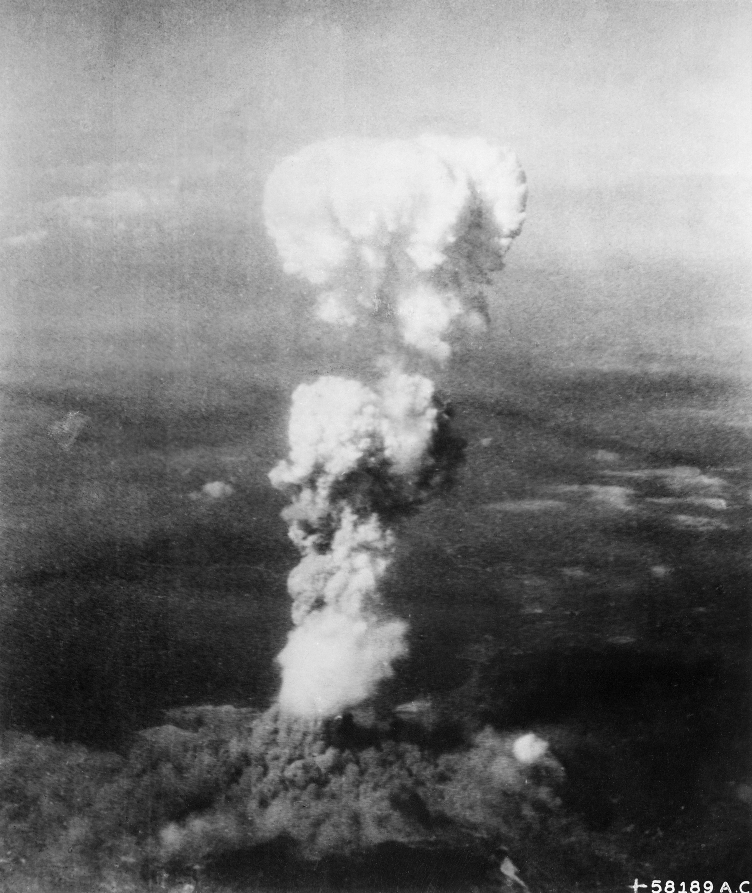
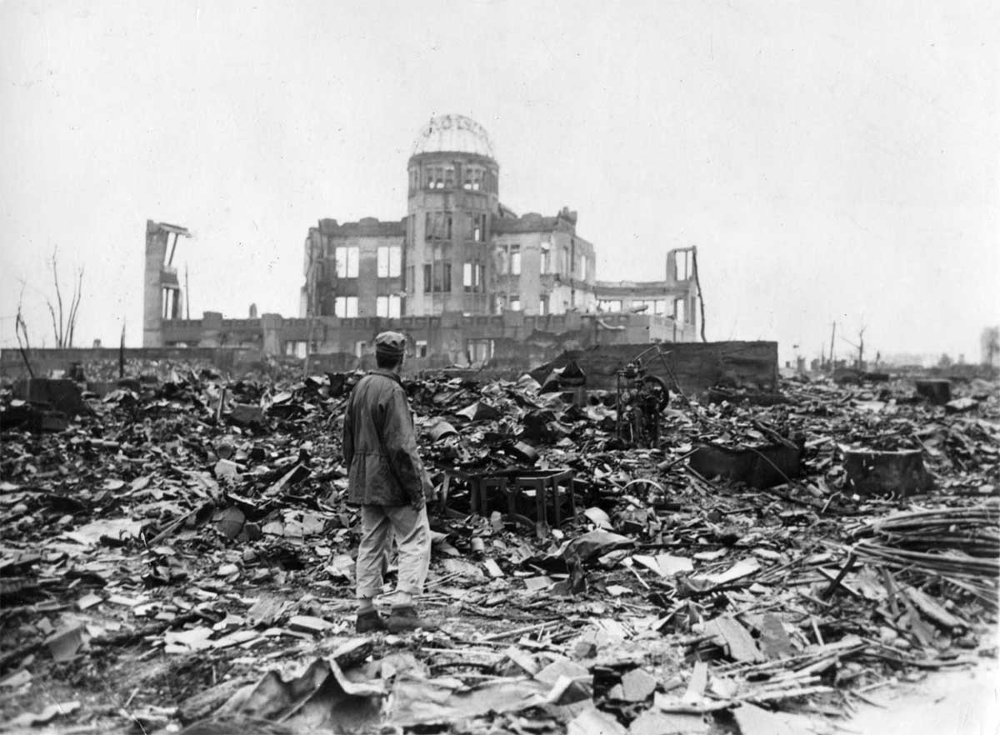
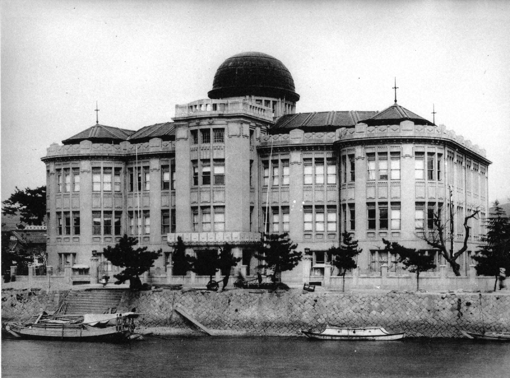
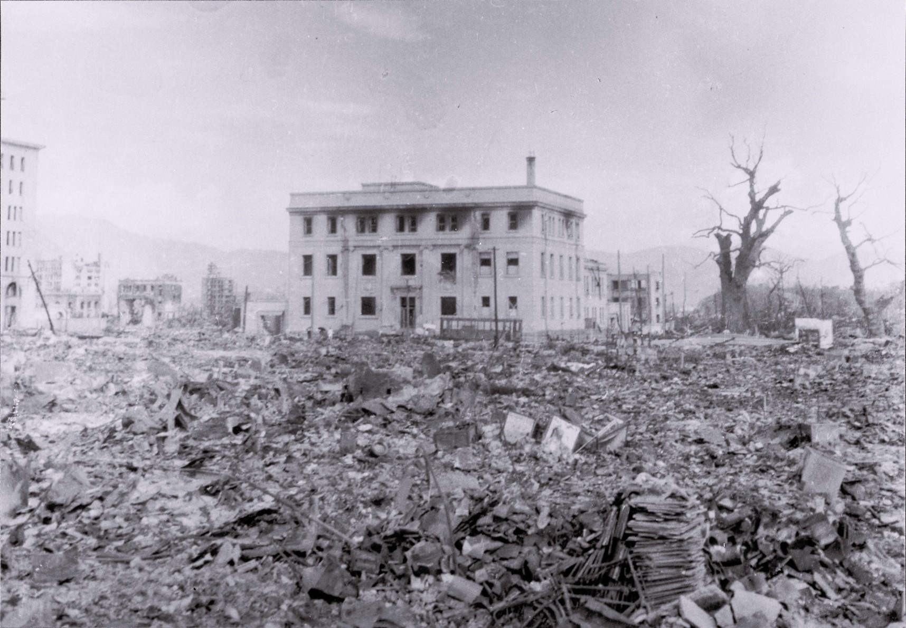
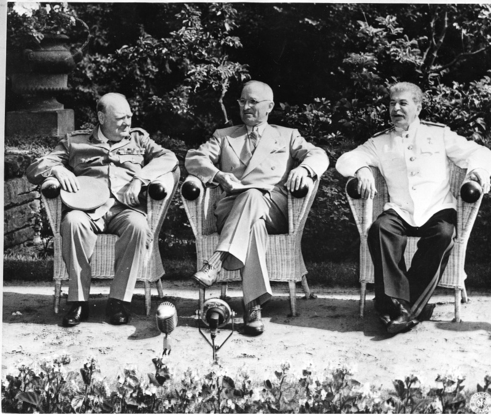



The story of Hiroshima is one that is tainted with destruction. In the final days of the Second World War, Hiroshima was reduced to rubble by the first atomic bomb on August 6th 1945. In the decades since its destruction, Hiroshima has been completely rebuilt from the ground up, but the legacy of the atomic bomb still lingers over not only the city but the entire world. How is it that we remember so vividly a place that no longer exists?  Even 81 years later, the image of the mushroom cloud over Hiroshima still sits so presently within Japanese, American, and international memory. Hiroshima is no longer just a place; it has been transformed into a symbol of the nuclear annihilation that lingers over our heads today. By mapping the history of Hiroshima, we can examine how its destruction affected places beyond the city itself. By mapping the blast radius, marking the locations of surviving structures as well as memorials and museums dedicated to Hiroshima, and tracing the flight paths of the bombers that dropped the bomb on Hiroshima and Nagasaki, the map illuminates how one destructive event in history unleashed consequences that affected the entire world.

*Mushroom Cloud Over Hiroshima. Source: George R. Caron, August 6th, 1945.*

A City of Peace.
	Hiroshima stands today as a city built on cinders; when the atomic bomb hit Hiroshima, it unleashed destruction on an unprecedented level. According to the initial reports of the destruction, over 80% of the city had been destroyed, with an estimate of 100 thousand casualties. In 1949, it was formally proclaimed as a “City of Peace” by the Japanese parliament as a way to advocate for global peace and later, nuclear disarmament. 
In the wreckage left in Hiroshima after the war, only a handful of buildings were left standing. Many of these surviving buildings were preserved as museums and memorials. The memorials serve as an enduring testament to the destructive consequences of the atomic bomb and a hope for future world peace. 

*An Allied Correspondent Standing Outside in the Rubble around the Genbaku Dome. Source: National Archives, Sep 7th, 1945*

*The Genbaku Dome before the Bomb, Source: Hiroshima Peace Memorial Museum*

The most well-known of the memorials is the Genbaku Dome, also known as the Atom Bomb Dome. Before the bombing, the Genbaku Dome was known as the Hiroshima Prefectural Industrial Promotional Hall. On August 6th, 1945, the first atomic bomb detonated only 150 meters away from the dome. The Genbaku Dome, due to its sturdy architecture, was the only building left standing near the hypocenter. In the 1950s and 1960s, the Hiroshima Peace Memorial Park and Hiroshima Peace Museum were both established around the Genbaku Dome; in 1966, it was established as the Hiroshima Peace Memorial. The Dome became a prominent symbol of non-nuclear proliferation groups and peace movements, and in December 1996, it was designated as a UNESCO World Heritage site. Today, sites like the Genbaku Dome and other memorials and museums are intended to remind the world of what nuclear weapons are capable of, and to advocate for a peaceful future in which these weapons are never unleashed again. 

*Bank of Japan, Hiroshima Branch Source: Toshio Kawamoto*

Hiroshima and its legacy on the world.
Hiroshima’s legacy is also deeply entrenched in many of the events occurring before, during, and after its destruction. Hiroshima’s memory is forever entwined with the end of WW2 and the dramatic entrance into the nuclear age. In late July of 1945, the leaders of the United States, Great Britain, and the Soviet Union assembled at the Potsdam Conference to discuss the end of the war in Europe and soon the end of the war with Japan. On July 26th, during the conference, the United States, Great Britain, and the Republic of China signed the Potsdam Declaration, an ultimatum against Japan. The Soviets abstained from signing the Potsdam Declaration as they weren’t at war with Japan during the conference. The Soviets would declare war on Japan until August 8th of that year.

“We call upon the Government of Japan to proclaim now the unconditional surrender of all the Japanese armed forces, and to provide proper and adequate assurances of their good faith in such action. The alternative for Japan is prompt and utter destruction.”  

*From Left To Right, British Prime Minister Churchill, American President Truman, and Soviet Premier Stalin at the Potsdam Conference. Source: United States Signal Corps, July 26th, 1945*

After Japan refused to respond to these demands, the United States attempted to force their hand with the atomic bomb. The Potsdam Declaration was itself influenced by another event that directly led to the bombing of Hiroshima: the Manhattan Project. 

*The Only Color Photo Taken of the Trinity Test. Source, Jack Aeby, July 16th, 1945*

The Trinity Test, the first successful test of an atomic bomb, and the culmination of years of scientific research occurred on July 16th, 1945, only ten days before the Potsdam Declaration was issued. Nine days after the Potsdam Declaration was issued the first atomic bomb “Little Boy” was dropped, Japanese officials were in complete disbelief of what had occurred. They had believed that the development of an atomic bomb was impossible, even for America. Many military officials initially refused to believe the bomb that had destroyed Hiroshima was even atomic. It was this hesitance by the military to acknowledge the existence of the atomic bomb that delayed Japanese surrender until after the Soviet declaration of war and the second atomic bomb being dropped in Nagasaki finally caused the Japanese to capitulate.

 Strangely, different governments attribute the end of the war to different things. American accounts of the end of the war attribute Japanese surrender to the Atomic Bombs. The Soviets believed that it was their declaration of war and subsequent invasion that caused the Japanese to surrender. Some Japanese officials, however, argue that the cause of their surrender was a combination of both atomic bombs and the impending Soviet invasion, which led them to finally agree to peace terms. 

The success of the Trinity Test marked the opening of Pandora’s Box for the destructive potential of nuclear weapons, which would be seen firsthand in Hiroshima and soon after in Nagasaki. The legacy of Hiroshima and the Atom Bomb has left a legacy that will affect the world forever. The destruction caused by the atomic bombs went on to shape society in the decades following the Second World War. 

The events of Hiroshima and Nagasaki heralded the establishment of America as a nuclear power. While to the world Hiroshima and Nagasaki remain as symbols of the horrors of nuclear war, they also still serve as prominent symbols of American military power and the victory of World War Two. 

*General MacArthur, and Emperor Hirohito Meeting For the First Time, Source: Gaetano Faillace, September 27th, 1945*

When the Soviet Union developed its own nuclear weapons in 1949, it established itself as the second nuclear superpower and cemented the rising fears of a nuclear war between the United States and the Soviets. This nuclear standoff, generated by the weapons that destroyed Hiroshima and Nagasaki, ushered in the era of the Cold War. 

Castle Romeo Test, Bikini Atoll, (Source: United States Department of Energy, March 27th, 1954)
The images of the mushroom cloud and the ruins of the two cities invaded the minds of the world. The Cold War was defined by the tensions of a potential nuclear war, the idea of which was terrifying because of what only one atomic bomb did to Hiroshima. The destructive legacy of Hiroshima and the atomic bomb completely changed how the world operated and still affects the world today, even after the conclusion of the Cold War.

What the Map Reveals.
	A map can reveal many things about the spatial history of a place. In the case of Hiroshima, the map shows us a visual representation of the blast radius of the atomic bomb as well as the buildings that were preserved to remember the destruction. The map makes use of individual points to highlight significant historical buildings that survived, museums, memorials, and other significant locations outside of Hiroshima. It also makes use of lines to trace the flight paths of the planes that dropped the bombs on Hiroshima and Nagasaki. Finally, the map features a polygon representing the blast radius of the atomic bomb. Together, each of these elements demonstrates how Hiroshima was connected to events around the world. The polygon provides us with a visual representation that gives us an understanding of the real scale of the destruction. When viewing the blast radius with the individual points, it gives us a better understanding of where some of the surviving buildings were located in the city and how close they were to the hypocenter. 

*Hiroshima Before and After the Blast, Source: US Army*

The individual points on the map also reveal how Hiroshima has preserved some elements of its destruction and transformed them into memorials and museums. The lines tracing the flight paths of the bombers connect Hiroshima to a wider historical context. The Bombers that launched from Tinian, an island in the Pacific, represent a significant event in the history of World War Two, with the B-29 Superfortress Enola Gay dropping the bomb on Hiroshima on August 6th, 1945, and Bock’s Car, another B-29, dropping the second bomb on Nagasaki three days later on August 9th. These flights represent a significant effort by the United States during the Second World War to force Japan to surrender and link the destruction of Hiroshima to the greater war effort in the Pacific. 

*Crew of the Enola Gay Source: US Air Force*

*Mushroom Cloud over Nagasaki Source: National Archives, August 9th, 1945*

They also connect Hiroshima with Nagasaki, as the cities whose destruction served as introductions to the nuclear age. By combining these points, lines, and the polygon, the map allows us to understand Hiroshima as more than just a city that was destroyed. It reveals a relationship between the destruction of Hiroshima, the military operations that caused it, and the memorials that preserve its memory. The map visualizes these connections in a way that a written description cannot do effectively. 

What The Map Does Not Reveal:
While the map reveals a lot about Hiroshima itself, the map cannot effectively represent the story of suffering that the survivors of Hiroshima endured. The people who survived Hiroshima became known as Hibakusha, or literally “those who have experienced, sustained, or undergone the atomic bomb.” The survivors of Hiroshima as well as Nagasaki suffered immensely from radiation exposure, horrific burns, and other injuries. 

*Grave marker inscribed with the word Senninzuka “Grave of Thousands”, on Ninoshima Island, about 10km away from the hypocenter.  Source: Shunkichi Kikuchi, Courtesy Harumi Tago*

*Photo of Hiroshima Survivors in the immediate aftermath. Source:Yoshito Matsushige/Courtesy Japan Professional Photographers Association, August 6th, 1945*

Hibakusha also often suffered from societal ostracization and discrimination due to fears that they were “contaminated” or “unclean” due to exposure to the bomb, struggling to find jobs or get married. There are so many stories of hardship and trauma that simply cannot be seen just by looking at a map of Hiroshima. These survivors are incredibly important to Hiroshima’s story, because they are living reminders of atomic devastation. There is a piece of the Hiroshima that no longer exists, still enduring within each of the survivors who witnessed its destruction. 

*I crawled desperately and got out from under my house. Crowds of people were fleeing to the north. Some were staggering along with such terrible injuries that their skin was hanging in shreds. Others sat by the road staring vacantly into space. The sight of human beings in this state is beyond imagination. Source: Drawn by Mitsuko Matsutomi, Special Exhibit: A-bomb Drawings—A People's Record of Hiroshima, Hiroshima Peace Memorial Museum,*

*Injured people fled along the river to avoid the flames. Then, the black rain fell. Source: Kichinosuke Tamada, Special Exhibit: A-bomb Drawings—A People's Record of Hiroshima, Hiroshima Peace Memorial Museum,* 

An example of this can be seen in a special exhibit put together by the Hiroshima Peace Museum entitled “A People’s Record of Hiroshima.” This exhibit contains a large collection of drawings created by Hibakusha showing the vivid memories of survivors who endured the atomic bombing. Drawings created by survivors, as well as Oral testimony and photographs, do much more to truly capture the trauma and the experiences of Hibakusha. 

*Crossing Misasa Bridge carrying a boy who was injured and calling for help. Source: Drawn by Kichinosuke Tamada, Special Exhibit: A-bomb Drawings—A People's Record of Hiroshima, Hiroshima Peace Memorial Museum,*

*People went completely bald, bled from their skin and gums, and later died. Source: Drawn by Fumie Munakata Special Exhibit: A-bomb Drawings—A People's Record of Hiroshima, Hiroshima Peace Memorial Museum,*

The role of Hibakusha as advocates for peace and nuclear non-proliferation is significant. Organisations such as Nihon Hidankyo (Japan Confederation of A- and H-Bomb Sufferers Organizations) were formed from the survivors of the atomic bomb to advocate for the abolition of nuclear weapons and a more peaceful world.

Conclusion:
Hiroshima’s legacy is a complicated one; the consequences of its destruction are reaching far beyond the city itself and still influence the world to this day. The surviving buildings and memorials preserve the physical remains of a city that no longer exists, while locations such as the Potsdam Conference and the flight path lines originating out of North Tinian Air Base remind us that these events were connected to a much larger effort to end the Second World War, and its consequences extended beyond it into the Cold War to today. The polygon marking the blast radius provides a physical geographic representation of the destruction that words cannot visualize effectively. While a written description can tell us what happened to Hiroshima, a historical map shows us where it happened, how far its consequences stretched, and how the memory of that destruction affects us today.

Bibliography:

Grunow, Tristan. “A Reexamination of the ‘Shock of Hiroshima’: The Japanese Bomb Projects and the Surrender Decision.” The Journal of American-East Asian Relations 12, no. 3/4 (2003): 155–89. http://www.jstor.org/stable/23613228.

Pant, G. S. “Hiroshima: The Lingering Effects.” India International Centre Quarterly 14, no. 2 (1987): 59–68. http://www.jstor.org/stable/23001419.

Sodei, Rinjiro. “Hiroshima/Nagasaki as History and Politics.” The Journal of American History 82, no. 3 (1995): 1118–23. https://doi.org/10.2307/2945118.

U.S. Department of State. "Proclamation by the Heads of Governments, United States, China and the United Kingdom [Potsdam Declaration]." July 26, 1945. In Foreign Relations of the United States: Diplomatic Papers, The Conference of Berlin (The Potsdam Conference), 1945, vol. 2, 1474–76. Washington, DC: U.S. Government Printing Office, 1960. https://history.state.gov/historicaldocuments/frus1945Berlinv02/d1382.

Hibakusha Stories. “Who Are The Hibakusha?” November 18, 2022. https://hibakushastories.org/who-are-the-hibakusha/.

  Nihon Hidankyo (Japan Confederation of A- and H-Bomb Sufferers Organizations), "Home," https://www.nihon-hidankyo.org/english/. 

UNESCO World Heritage Centre. "Hiroshima Peace Memorial (Genbaku Dome)." Accessed November 15, 2026. https://whc.unesco.org/en/list/775/. 

Hiroshima Peace Memorial Museum. "A People's Record of Hiroshima." Special Exhibit: A-bomb Drawings—A People's Record of Hiroshima. Accessed November 15, 2026. https://hpmmuseum.jp/virtual/VirtualMuseum_e/exhibit_e/exh0303_e/exh03034_e.html. 

https://seamoose682.github.io/The-Hiroshima-Project/

