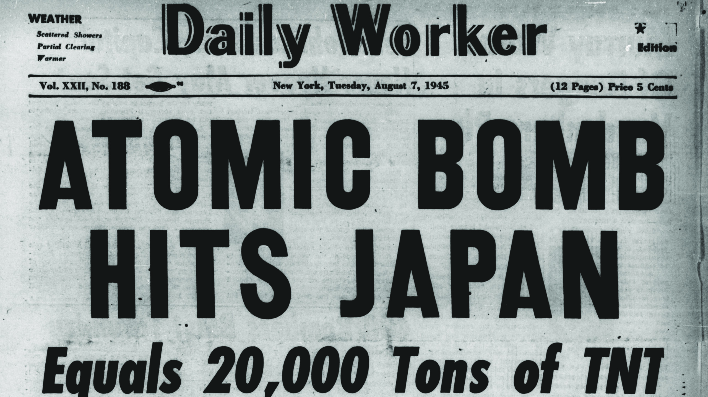
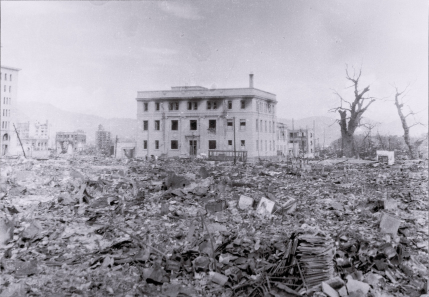
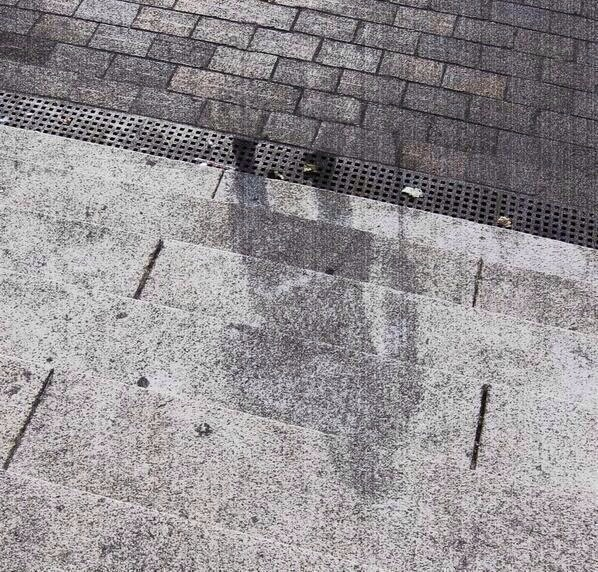
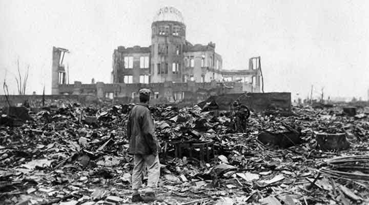



# Hiroshima: A Legacy of Annihilation

A spatial history of the Japanese City of Hiroshima and its place in an interconnected world!

## Hiroshima as an Interconnected Place.

<iframe src="map/" width="120%" height="520"
style="border:1px solid #ccc; border-radius:8px;"></iframe>

[Read the essay](essay.html)

